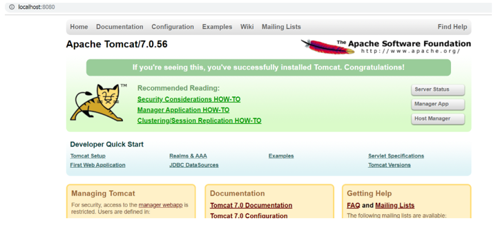

# ⚙️ Middleware Administration | Apache Tomcat & Web Server Fundamentals

## 📌 1. Overview

This module documents middleware administration assignments completed during the **Cognizant CIS Multicloud technical capstone training program**.

The training covered Apache Tomcat installation and configuration, Java web application fundamentals, client-server communication, inter-process communication (IPC), and Apache HTTP Server administration.

The module includes a documented Apache Tomcat connectivity exercise and theoretical coverage of middleware communication, web server configuration, routing, and load balancing.

## 🛠️ 2. Technologies & Concepts Covered

| Technology / Concept | Purpose | Training Coverage |
|---|---|---|
| Apache Tomcat | Java web application hosting and servlet container | Configuration and connectivity exercise |
| Java | Runtime environment for Java applications | Fundamentals |
| HTML and JSP | Web application components | Application structure |
| Apache HTTP Server | HTTP request handling and web content delivery | Web server concepts |
| HTTP and TCP/IP | Client-server communication | Theory |
| IPC | Communication between processes | Theory |
| Virtual Hosts | Hosting multiple websites on one server | Theory |
| Load Balancing | Distributing requests across servers | Theory |

## 🎯 3. Technical Objectives

- Understand middleware architecture and its purpose.
- Study Apache Tomcat installation and configuration.
- Understand the structure of Java web applications.
- Review Java and Tomcat environment variables.
- Verify Apache Tomcat server accessibility.
- Understand client-server request-response communication.
- Explore common IPC mechanisms.
- Study Apache HTTP Server administration.
- Understand virtual hosting and request routing.
- Explore load balancing and static website deployment.

---

## ☕ 4. Assignment 1 — Install & Configure Apache Tomcat

### 4.1 Apache Tomcat Overview

Apache Tomcat is an open-source Java servlet container used to run Java-based web applications.

It supports technologies such as Java Servlets and JavaServer Pages (JSP).

Tomcat receives HTTP requests, processes them through its configured components, and returns responses to clients.

### 4.2 Tomcat Installation & Setup

The assignment covered the following setup activities:

1. Download Apache Tomcat.
2. Prepare the Java runtime environment.
3. Configure the Tomcat installation.
4. Review Java web application deployment.
5. Start the Tomcat server.
6. Test server connectivity through a browser.

These activities introduced the basic workflow for setting up a Java application hosting environment.

### 4.3 Java Web Application Structure

The training covered the components commonly found in Java web applications.

| Component | Purpose |
|---|---|
| HTML | Defines webpage structure |
| JSP | Supports server-side generation of web content |
| Java Classes | Implement application functionality |
| Configuration Files | Define application and deployment settings |

The assignment also introduced how applications are deployed to Apache Tomcat and accessed through a web browser.

### 4.4 Environment Variables

Environment variables help identify software installation locations.

| Variable | Purpose |
|---|---|
| `JAVA_HOME` | Specifies the Java installation directory |
| `CATALINA_HOME` | Specifies the Apache Tomcat installation directory |

These settings are relevant when configuring the Java runtime and Tomcat environment.

### 4.5 Server Connectivity Verification

The documented lab tested Apache Tomcat through:

```text
http://localhost:8080
```

**Technical Explanation:**

- `localhost` refers to the local computer.
- `8080` is a commonly used default HTTP connector port for Apache Tomcat.
- The browser sends an HTTP request to the Tomcat service.
- Tomcat returns an HTTP response.

### Verification Result

The assignment includes a screenshot of the Apache Tomcat default welcome page.

This demonstrates that the Tomcat service was accessible through the local HTTP endpoint.

### Technical Outcome

Explored Apache Tomcat configuration, Java application hosting fundamentals, environment variables, and browser-based server connectivity verification.

---

## 🔄 5. Assignment 2 — Middleware Communication Simulation

### 5.1 Client-Server Architecture

Client-server architecture enables communication between systems through requests and responses.

**Basic Communication Flow:**

```text
          Client / Browser
                 |
                 | Request
                 v
           Server / Middleware
                 |
                 | Processing
                 v
          Application Component
                 |
                 | Response
                 v
          Client / Browser
```

**Client Responsibilities:**

- Initiates requests.
- Sends data to a server.
- Receives and displays responses.

**Server Responsibilities:**

- Receives incoming requests.
- Processes the requested operation.
- Returns the appropriate response.

Middleware supports communication and interaction between application components.

### 5.2 Middleware Communication Protocols

A communication protocol defines rules for exchanging data between connected systems.

The assignment covered HTTP and TCP/IP fundamentals.

| Protocol | Function |
|---|---|
| HTTP | Supports web-based request-response communication |
| TCP | Provides reliable, connection-oriented data transport |
| IP | Supports packet addressing and routing |

These protocols help applications communicate across networks using standardized mechanisms.

### 5.3 Inter-Process Communication (IPC)

Inter-Process Communication enables processes to exchange information and coordinate activities.

The training covered three common IPC mechanisms.

| IPC Method | Description |
|---|---|
| Sockets | Enable communication between processes, including across networks |
| Message Queues | Allow processes to exchange messages |
| Pipes | Transfer data between processes through a communication channel |

### Technical Outcome

Developed an understanding of client-server communication, request-response processing, network protocols, and IPC fundamentals.

---

## 🌐 6. Assignment 3 — Web Server Setup & Configuration

### 6.1 Apache HTTP Server

Apache HTTP Server is an open-source web server used to deliver web content to clients.

Its responsibilities include:

- Receiving HTTP requests.
- Processing configured request-handling rules.
- Serving web resources.
- Returning HTTP responses to browsers.

### 6.2 Virtual Host Configuration

Virtual hosting allows multiple websites to be hosted using a single web server.

Each website can have its own:

- Domain or hostname.
- Document root.
- Configuration settings.

**Conceptual Example:**

```text
             Apache HTTP Server
                     |
              Virtual Host Rules
                 /         \
                v           v
         website-a.com   website-b.com
```

Virtual hosting helps organize multiple websites and utilize server resources efficiently.

### 6.3 Request Routing

Request routing determines how incoming requests are directed to the appropriate resources.

The training covered the purpose of routing rules in organizing web applications and services.

Routing can be based on factors such as:

- Requested hostname.
- URL path.
- Server configuration.

### 6.4 Load Balancing

Load balancing distributes incoming requests across multiple backend servers.

**Conceptual Architecture:**

```text
                Clients
                   |
                   v
              Load Balancer
                 /      \
                v        v
            Server 1   Server 2
```

**Key Benefits:**

- Distributes application traffic.
- Helps prevent individual server overload.
- Can improve service availability.
- Supports scalable application architectures.

The assignment introduced the purpose and benefits of load balancing in web infrastructure.

### 6.5 Static Website Deployment

A static website contains predefined content delivered to users through a web server.

Typical components include:

- HTML files.
- CSS stylesheets.
- Images and other static assets.

The assignment covered how static website files are hosted and accessed through a browser.

### Technical Outcome

Studied Apache HTTP Server administration, virtual hosting, request routing, load balancing, and static website deployment fundamentals.

---

## ✅ 7. Assignment Review & Verification

| Assignment | Technical Coverage | Evidence / Learning |
|---|---|---|
| Apache Tomcat | Installation, configuration, environment variables | Tomcat connectivity screenshot |
| Java Web Applications | HTML, JSP, application structure, deployment | Application hosting concepts |
| Middleware Communication | Client-server model, HTTP, TCP/IP | Theoretical understanding |
| IPC | Sockets, message queues, pipes | Theoretical understanding |
| Apache HTTP Server | Web server setup and request handling | Configuration concepts |
| Virtual Hosts & Routing | Website hosting and request routing | Theoretical understanding |
| Load Balancing | Traffic distribution and availability | Theoretical understanding |
| Static Website | HTML/CSS hosting and browser access | Deployment concepts |

---

## 📸 8. Supporting Evidence

### Apache Tomcat — Server Connectivity Verification

The screenshot documents access to the Apache Tomcat default welcome page using:

`http://localhost:8080`

The result demonstrates basic HTTP connectivity between the browser and the local Tomcat service.



---

## 🧠 9. Key Learning Outcomes

- Understood Apache Tomcat and its role in Java web application hosting.
- Reviewed Tomcat installation and configuration.
- Learned the purpose of `JAVA_HOME` and `CATALINA_HOME`.
- Verified basic Tomcat server connectivity.
- Explored Java web application structure and deployment.
- Understood client-server request-response communication.
- Studied HTTP and TCP/IP fundamentals.
- Learned IPC concepts involving sockets, message queues, and pipes.
- Explored Apache HTTP Server administration.
- Understood virtual hosts and request routing.
- Studied load balancing and static website hosting.

---

## 🚀 10. Lab Summary

This middleware capstone covered Apache Tomcat, Java web application fundamentals, client-server communication, IPC, and web server administration.

The documented Tomcat connectivity exercise demonstrates basic server accessibility, while the remaining assignments establish foundational knowledge of middleware architecture, web hosting, routing, and load balancing.

These concepts support further learning in cloud infrastructure, application deployment, and DevOps engineering.
